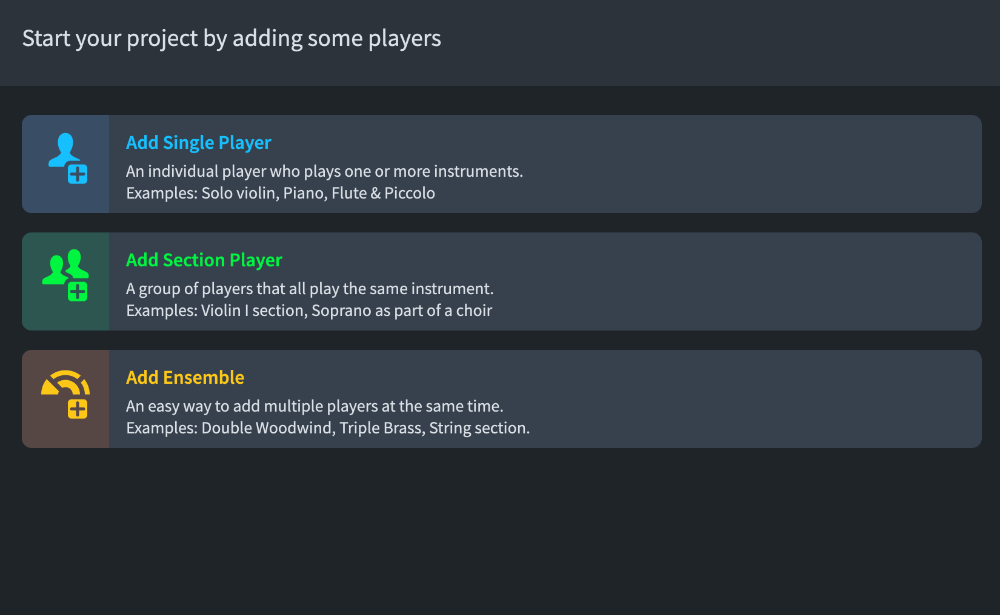

今天（2026-10-23）是學習 Dorico 的第二天，距離上次已經有了整整一個多月的時間

簡單的介紹：

## Setup Page

首先開啟 Setup 分頁分成單一樂手、多重樂手、編制模板

### 1.Add Single Player

- **支援樂器切換 (Instrument Change)**：如果你分配給他「長笛」和「短笛」，當樂譜上長笛閒置時，Dorico 會自動幫你在譜上寫「換短笛 (To Piccolo)」，並在同一行五線譜上切換記譜，不需要你手動開兩行。
- **獨奏專用**：適合用於鋼琴（一個人彈雙手譜）、獨奏小提琴、或是管樂團中各別的席次（如 Flute 1、Flute 2）。
- 簡單說：管樂要換不同樂器就用 Single Player

### 2.Add Section Player

- **不支援轉化多樂器**：一個 Section 只能指定一種樂器，不能像單一樂手那樣在中途轉換成其他樂器。
- **支援分譜 (Divisi)**：這是它最強大的地方！在交響樂團的「第一小提琴（Violin I）」或合唱團的「女高音（Soprano）」中，當音樂需要一分為二（如外側、內側琴手彈不同音）時，你可以使用 Divisi 功能，Dorico 會在同一個總譜行中漂亮地拉出兩行分譜，並在分譜結束後自動合併。 
- 簡單說：弦樂要分兩部不同音就使用 Section Player
### 3.Add Ensemble

- **純粹是模板工具**：它本身不是一種新的樂手型態。當你點擊它時，它可以讓你一鍵加入「雙管編制木管組」、「銅管五重奏」或「弦樂五部」。
- 點擊並選好後，Dorico 會**自動幫你生成對應的數個 Single Players 或 Section Players**。例如選擇弦樂組，它就會幫你打包自動建好 Violin I (Section)、Violin II (Section)、Viola (Section) 等，省去你一個一個手動加的時間。 

第三個類似 Template 的概念

## Write Page

先列出會用到的快捷鍵：

- Enter (Shift + N) : 輸入音符模式
- Shift + K : 換調號 (K = Key Signature)
輸入：G / g / 1# / 3b / 1s / 6f 都可以 (大寫代表大調、小寫代表小調、S = Sharp、f = flate)
- Shift + M : 更改拍號 (M = Measure)
輸入：3/4 代表四分音符為一拍、一小節有三拍
- Shift + B : 新增小節 (B = Bar)
選中 **小節線** 後，輸入數字即可
- Ctrl / Command + 滑鼠滾輪 : 放大縮小
- Shift + 滑鼠滾輪 : 左右平移移動

###  第一種輸入模式 (音符輸入模式)

1. 按快捷鍵：Shift + N (或按下 Enter) 開啟音符輸入模式
2. 8 是全音符、7 是二分音符、6 是四分音符、5 是八分音符、4 是十六分音符 ... 依此類推
3. 若需要休止符，則使用 Space 代替
4. 若需加入負點，則按下 . 鍵
5. 若需加入升降記號，則使用 0 - = (分別代表：還原記號 / 降記號 / 升記號)

目前學到第九課：

【9：dorico输入附点音符】 https://www.bilibili.com/video/BV1qVESzaEb3/?share_source=copy_web&vd_source=d623ebb517f049fce0f2539f3dfb6911
